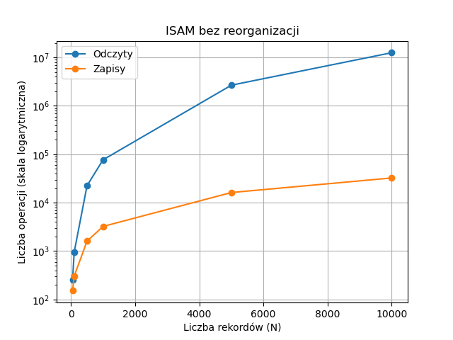
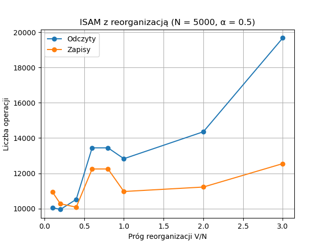
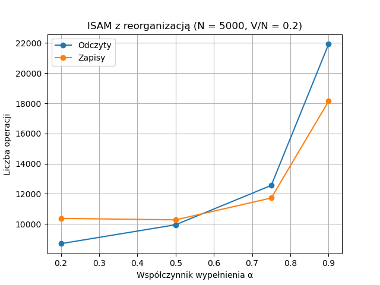

# Index-Sequential File Organization (ISFO)

A C++20 implementation of index-sequential file organization, developed for the **Database Structures** course.

The project combines an ordered main data file, a sparse index, and an overflow area. It supports record insertion, retrieval, updates, logical deletion, and file reorganization, with disk I/O statistics for evaluating performance.

## Build and Run

### Requirements

- A C++20-capable compiler.
- CMake **4.0 or newer**, as required by `CMakeLists.txt`.
- The **fmt** library, installed with its CMake package configuration available to `find_package(fmt REQUIRED)`.
- A build tool compatible with the selected CMake generator.

### Build and Run

Run the following commands from the project root:

```sh
cmake -S . -B build -DCMAKE_BUILD_TYPE=Release
cmake --build build --config Release
```

The executable target is named `p2`.

If CMake cannot locate fmt, provide its installation prefix:

```sh
cmake -S . -B build -DCMAKE_BUILD_TYPE=Release -DCMAKE_PREFIX_PATH="/path/to/fmt/install"
cmake --build build --config Release
```
After succesfull build:
```sh
./build/p2
```
Use the interactive menu to select operations. Enter `q` to quit the program.

## Indexing Method

The selected indexing method is **index-sequential file organization**. It combines sorted data storage with indexed access:

- The main file is sorted by record key.
- A sparse index stores the key and address of the first record on each page.
- New records that cannot fit into their target main-file page are stored in an overflow area and linked into overflow chains.

## Implementation

### Data Structures

- **Record:** Based on the structure from assignment 1, extended with a natural-number key.
- **Page:** The unit of disk reads and writes. The demonstration and experiments use a blocking factor of \(b = 4\), meaning four records per page.
- **Pointers:** Represented by page addresses and offsets within the files.

### Disk I/O Statistics

The program counts file reads and writes for insertion, update, retrieval, reorganization, and deletion. Use `s` to inspect statistics for individual operation types or `o` to display an aggregate operation summary.

### Supported Operations

| Operation | Description |
| --- | --- |
| Insert | Locate the appropriate page through the index. Insert into the main area if space is available; otherwise, insert into the overflow area and update the relevant pointers. |
| Read | Search the main area and the associated overflow chain for a record. |
| Browse | Read the main and overflow areas sequentially. |
| Reorganize | Merge overflow records into a new, ordered main area. Logically deleted records are excluded. |
| Delete | Set the record's `deleted` flag to `true`. The record is physically discarded during reorganization. |
| Update | If the key changes, delete the old record and insert it again. If the key remains unchanged, read the record, overwrite its data, and write it back. |

## Command Interface

The interactive menu provides the following commands:

```text
Choose an option:
Insert record(I/i)
Read record(R/r)
Delete record(D/d)
Update record(U/u)
View file(F/f)
View index(X/x)
Reorganize the file(E/e)
Show statistics(S/s)
Set parameter(P/p)
Operation summary(O/o)
Quit program (Q/q)
```

After an operation, the corresponding menu options can be used to inspect file contents and disk I/O counts.

### File Structure Output

Example output showing the main and overflow areas:

```text
f
Main START:
PAGE: 0
[0]id:3377,(M:0,S:0,D:0),ovrflw:(-1,-1)
[1]id:3585,(M:0,S:0,D:1),ovrflw:(0,0)
[2]id:7772,(M:0,S:0,D:2),ovrflw:(-1,-1)
[3]id:7893,(M:0,S:0,D:3),ovrflw:(-1,-1)
Main END
Overflow START:
PAGE: 0
[0]id:4528,(M:0,S:0,D:4),ovrflw:(-1,-1)
Empty record
Empty record
Empty record
Overflow END
Press any key to continue
```

## Test File Format

A test file contains one command and its parameters per line:

| Command | Purpose |
| --- | --- |
| `I <key> <data>` | Insert a record. |
| `R <key>` | Read a record. |
| `U <key> <new_data>` | Update a record. |
| `D <key>` | Delete a record. |
| `F` | Display the file structure. |
| `E` | Force reorganization. |
| `S` | Display I/O statistics for individual operation types. |
| `P` | Set parameters: alpha, automatic/manual reorganization, or the overflow ratio threshold. |

The example below uses lowercase commands and three numeric data fields per inserted record:

```text
p a 0.5
p o 0.2
p r 0
i 284367 0 0 0
i 438988 0 0 1
i 178528 0 0 2
i 462029 0 0 3
i 446273 0 0 4
i 363184 0 0 5
e
```

This example sets alpha to `0.5`, sets the overflow-to-main-record ratio threshold to `0.2`, disables automatic reorganization, inserts **six records**, and finally forces reorganization.

## Experiments and Results

### Objective

The experiments examine how configuration parameters affect operation cost, measured as the number of disk-page accesses.

### Parameters

| Parameter | Meaning |
| --- | --- |
| \(b\) | Records per disk page; fixed at 4 in the experiments. |
| \(N\) | Number of inserted records in the workload. |
| \(\alpha\) | Target fraction of each new main-file page filled during reorganization. |
| \(V/N\) | Overflow-to-main-record ratio used as the automatic reorganization threshold. Here, the denominator denotes the number of main-area records, rather than the total workload size. |

### Record Count Without Reorganization

The first experiment measures disk I/O as the number of inserted records increases, with automatic reorganization disabled.



*Figure 1. Disk I/O operations relative to the number of inserted records, without automatic reorganization.*

| Records (N) | Reads | Writes | Total I/O operations |
| ---: | ---: | ---: | ---: |
| 50 | 256 | 152 | 408 |
| 100 | 950 | 303 | 1,253 |
| 500 | 22,393 | 1,607 | 24,000 |
| 1,000 | 76,951 | 3,232 | 80,183 |
| 5,000 | 2,674,212 | 16,210 | 2,690,422 |
| 10,000 | 12,536,368 | 32,418 | 12,568,786 |

Without reorganization, read counts increase sharply for large workloads. Inserting a single record may require traversing a long overflow chain spread across many pages.

### Page Fill Factor

The second experiment examines the effect of alpha with automatic reorganization enabled and 5,000 inserted records.



*Figure 2. Disk I/O operations relative to the page fill factor alpha, with automatic reorganization enabled.*

| Alpha | Records (N) | Reads | Writes | Total I/O operations |
| ---: | ---: | ---: | ---: | ---: |
| 0.2 | 5,000 | 8,696 | 10,373 | 19,069 |
| 0.5 | 5,000 | 9,951 | 10,275 | 20,226 |
| 0.75 | 5,000 | 12,559 | 11,724 | 24,283 |
| 0.9 | 5,000 | 21,922 | 18,143 | 40,065 |

A lower alpha leaves more free slots in main-file pages after reorganization, allowing more insertions directly into pages reached through the index. Higher alpha values use main-area space more efficiently but can increase disk I/O as overflow chains grow.

### Reorganization Threshold

The third experiment examines how the overflow-to-main-record ratio threshold affects disk I/O with automatic reorganization enabled.



*Figure 3. Disk I/O operations relative to the reorganization threshold V/N, with automatic reorganization enabled.*

| V/N | Reads | Writes | Total I/O operations |
| ---: | ---: | ---: | ---: |
| 0.1 | 10,061 | 10,944 | 21,005 |
| 0.2 | 9,951 | 10,275 | 20,226 |
| 0.4 | 10,524 | 10,083 | 20,607 |
| 0.6 | 13,446 | 12,247 | 25,693 |
| 0.8 | 13,446 | 12,247 | 25,693 |
| 1.0 | 12,829 | 10,970 | 23,799 |
| 2.0 | 14,357 | 11,223 | 25,580 |
| 3.0 | 19,675 | 12,551 | 32,226 |

Less frequent reorganization generally increases disk I/O because overflow chains remain longer. The measured relationship is not strictly monotonic: among the tested thresholds, `0.2` produces the lowest total I/O count.

### Findings

- Without reorganization, long overflow chains cause a sharp increase in disk reads as the dataset grows.
- Lower alpha values reduce read counts by leaving room for future insertions in indexed main-file pages.
- Higher alpha values trade lower main-area space overhead for potentially greater overflow-chain traversal costs.
- Reorganization frequency must balance the cost of rebuilding the file against the cost of traversing overflow chains.
